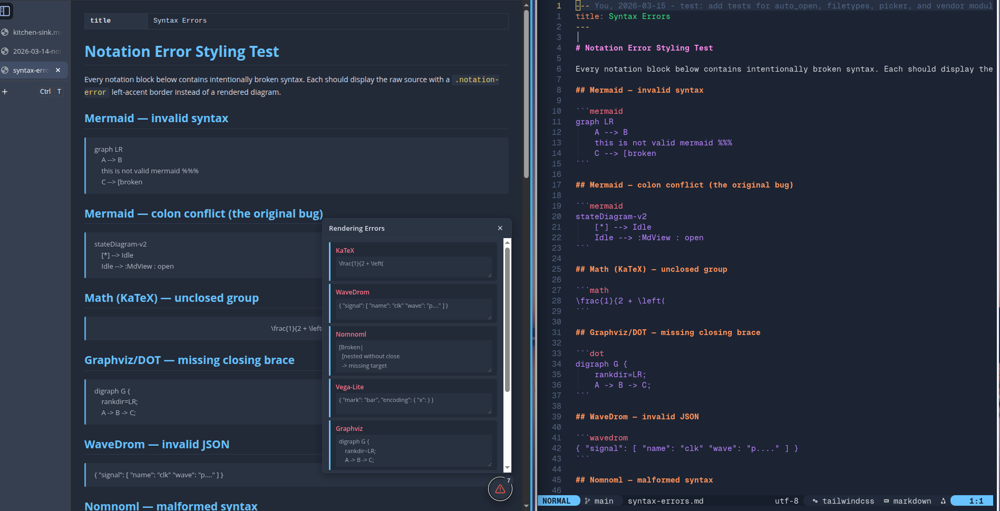

# Notations

md-view renders notation languages embedded in fenced code blocks. All are enabled by default and loaded from CDN (or the offline cache).

| Notation | Fence language |
|----------|----------------|
| Mermaid | `mermaid` |
| KaTeX | `math`, `$...$`, `$$...$$` |
| Graphviz | `dot`, `graphviz` |
| WaveDrom | `wavedrom` |
| Nomnoml | `nomnoml` |
| abcjs | `abc` |
| Vega-Lite | `vega-lite` |

Syntax errors show inline in the preview, so you can iterate on a diagram with fast feedback:



**Disable a notation** to skip loading its library:

```lua
require("md-view").setup({
  notations = {
    katex = { enable = false }, -- skip loading KaTeX (~280 KB)
  },
})
```

**Set a mermaid diagram theme** (`nil` picks one to match the page theme):

```lua
require("md-view").setup({
  notations = {
    mermaid = { theme = "forest" },
  },
})
```
