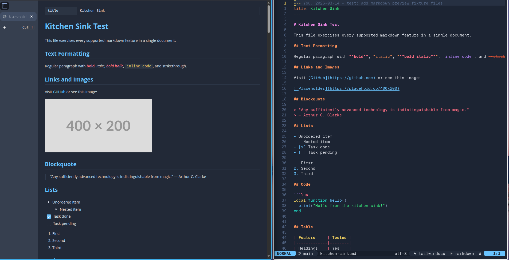

# Theming

## Syntax highlighting themes

Fenced code blocks with a language tag are highlighted with [highlight.js](https://highlightjs.org). Set `theme.syntax` to any theme from the [highlight.js demo](https://highlightjs.org/demo). `nil` auto-selects `"vs2015"` for dark themes and `"github"` for light themes.

Some popular dark themes: `"vs2015"`, `"github-dark"`, `"github-dark-dimmed"`, `"atom-one-dark"`, `"monokai"`, `"dracula"`, `"nord"`, `"tokyo-night-dark"`, `"catppuccin-mocha"`.

Some popular light themes (pair with custom `css` to change the background): `"github"`, `"vs"`, `"atom-one-light"`, `"catppuccin-latte"`.

```lua
require("md-view").setup({
  theme = { syntax = "github-dark" },
  notations = {
    mermaid = { theme = "dark" },
  },
})
```

## Custom CSS

The `css` option injects a raw CSS string after all built-in styles. The page exposes CSS custom properties (`--md-bg`, `--md-fg`, `--md-link`, …) so you can restyle elements without fighting specificity — see the full list in [options.md](../options.md#css-custom-properties).

**Wider content area** (default `max-width` is `882px`):

```lua
require("md-view").setup({
  css = "body { max-width: 1100px; }",
})
```

**Custom font and larger base size:**

```lua
require("md-view").setup({
  css = [[
    body {
      font-family: "Georgia", serif;
      font-size: 16px;
      line-height: 1.8;
    }
  ]],
})
```

**Light theme with a warm background** (pair with a light syntax theme):

```lua
require("md-view").setup({
  theme = { mode = "light", syntax = "github" },
  css = [[
    :root {
      --md-bg: #faf8f5;
      --md-code-bg: #f0ede8;
    }
  ]],
})
```

**Full-width, no side padding** (useful on wide monitors):

```lua
require("md-view").setup({
  css = "body { max-width: none; padding: 0 48px; }",
})
```

## Colorscheme sync

Set `theme.mode = "sync"` to mirror your Neovim colorscheme. Colors are extracted from highlight groups and pushed to the browser on every `ColorScheme` event — no page reload needed.

```lua
require("md-view").setup({ theme = { mode = "sync" } })
```



Use `theme.highlights` to override which highlight groups are sampled. Values can be a single group or a list — the first group that has the attribute wins:

```lua
require("md-view").setup({
  theme = {
    mode = "sync",
    highlights = {
      heading = "@markup.heading",
      link = { "MyLink", "Underlined" },
    },
  },
})
```

See [options.md](../options.md#themehighlights-keys) for every key and its default groups. `theme.highlights` has no effect unless `theme.mode = "sync"`.

## Switching themes live

`:MdViewTheme dark|light|auto|sync` switches the theme of open previews without changing your config. With no argument it cycles through the modes.
